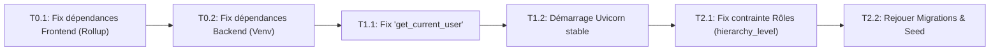
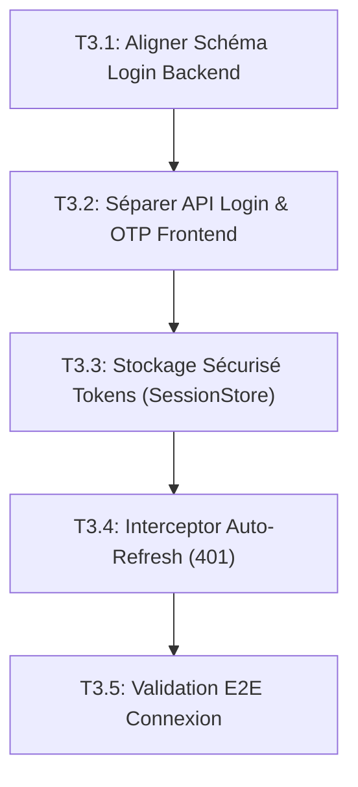
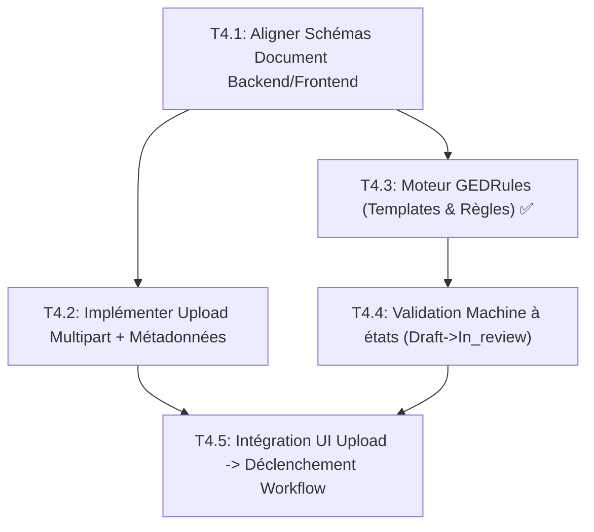
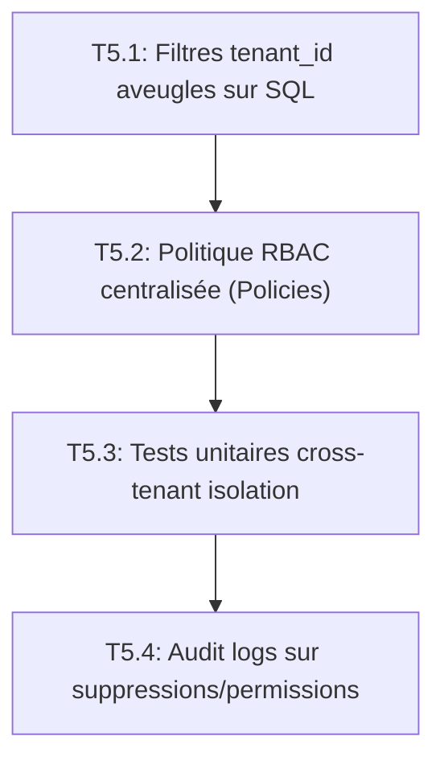
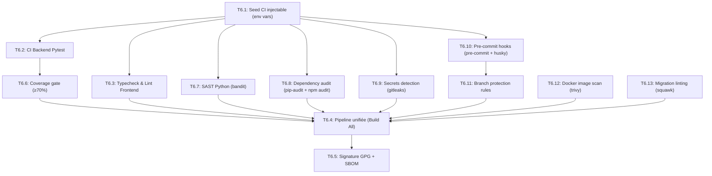
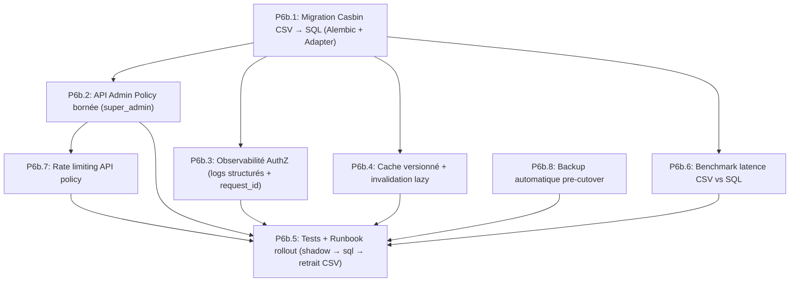
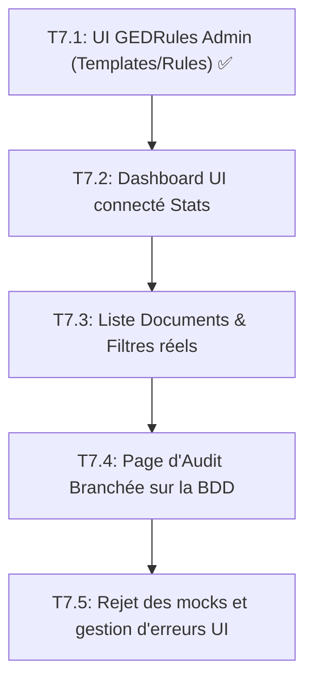

# PERT Global du Projet GED237

Ce document regroupe les diagrammes PERT (Program Evaluation and Review Technique) modélisant le chemin critique et les dépendances des travaux. Le document commence par une vision Macro (toutes les phases de P0 à P2) puis détaille un PERT micro pour chaque sous-phase.

---

## 1. MACRO PERT : Toutes les phases (P0 à P2)

Ce graphe représente l'enchaînement global des grandes phases du projet décrites dans le plan de réparation.

```mermaid
graph TD
    %% MACRO PHASES
    SubGraph_P0["🔴 P0 - Remédiation & Fondations"]
    P0["Phase 0: Stabilisation Env."]
    P1["Phase 1: Redémarrage Backend"]
    P2["Phase 2: Migration BDD"]
    P3["Phase 3: Contrat Auth Front/Back"]
    end

    SubGraph_P1["🟡 P1 - Consolidation & Métier"]
    P4["Phase 4: Documents & Workflow"]
    P5["Phase 5: Sécurité Multi-Tenant"]
    P6["Phase 6: Qualité & CI"]
    P6b["Phase 6b: AuthZ Production-Grade"]
    end

    SubGraph_P2["🟢 P2 - Interface & Déploiement"]
    P7["Phase 7: Conversion Maquettes UI -> API"]
    end

    %% DEPENDENCES MACRO
    P0 --> P1
    P1 --> P2
    P2 --> P3
    P3 --> P4
    P3 --> P5
    P4 --> P6
    P5 --> P6
    P5 --> P6b
    P6 --> P6b
    P6b --> P7
    P4 --> P7

    classDef p0 fill:#ffebee,stroke:#c62828,stroke-width:2px,color:#000;
    classDef p1 fill:#fff3e0,stroke:#ef6c00,stroke-width:2px,color:#000;
    classDef p2 fill:#e8f5e9,stroke:#2e7d32,stroke-width:2px,color:#000;

    class P0,P1,P2,P3 p0;
    class P4,P5,P6,P6b p1;
    class P7 p2;
```

> **Chemin Critique Macro :** `P0 -> P1 -> P2 -> P3 -> P4 -> P6 -> P6b -> P7`

---

## 2. MICRO PERTs : Détail par Phase

### Phase 0 à 2 : Fondations (P0)


### Phase 3 : Contrat Auth Front/Back (P0)


### Phase 4 : Documents Et Workflows (P0/P1)
**C'est la phase actuellement en cours d'achèvement.**


### Phase 5 : Sécurité Multi-Tenant & Autorisation (P1)


### Phase 6 : Qualité, CI & DevSecOps (P1)


### Phase 6b : AuthZ Production-Grade (P1)


### Phase 7 : Conversion Maquettes UI (P2)

