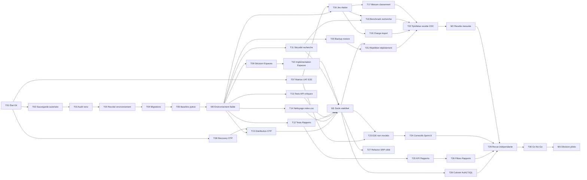
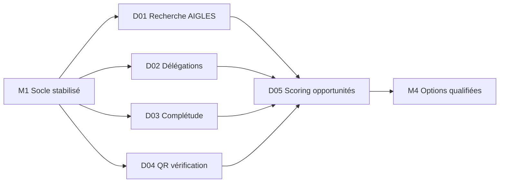

# PERT d'exécution GED237 — 2026-07-22

> Statut : Proposé — estimations à rebaseliner après T06
> Auteur : Product Owner assisté
> Date : 2026-07-22
> Objectif : visualiser dépendances, parallélisme, chemin critique et jalons
> Référence : `PLAN_EXECUTION_GED237_2026-07-22.md`
> Unité : jour ouvré idéal

## 1. Hypothèses

- Une seule capacité principale d'implémentation : Claude.
- Gemini travaille en parallèle sur la Discovery, l'exploration frontend en
  lecture seule, la recette et la documentation.
- Le PO arbitre sans être compté comme une capacité de développement.
- Les accès PostgreSQL, Redis, remote Git et services externes sont disponibles.
- Les estimations sont des ordres de grandeur, pas des engagements calendaires.
- Toute anomalie majeure découverte par T06 déclenche une nouvelle estimation.

## 2. Réseau PERT



## 3. Registre des tâches

| ID | Tâche | Durée | Prédécesseurs | R | A | Sortie vérifiable |
|---|---|---:|---|---|---|---|
| T01 | État Git et remote | 0,25 | — | Claude | PO | Snapshot daté |
| T02 | Sauvegarde autorisée | 0,25 | T01 | Claude | PO | Statut local/remote prouvé |
| T03 | Audit `venv/` et `.venv/` | 0,25 | T02 | Claude | Claude | Fichiers suivis identifiés |
| T04 | Recréer environnement Python | 0,5 | T03 | Claude | Claude | Python et dépendances utilisables |
| T05 | Vérifier migrations | 0,25 | T04 | Claude | Claude | Deux bases au head |
| T06 | Baseline pytest | 0,75 | T05 | Claude | Claude | Rapport complet |
| T07 | Matrice UAT ↔ E2E | 1,5 | T01 | Gemini | PO | Traçabilité sans collision |
| T08 | Discovery canal OTP | 0,75 | T01 | Gemini | PO | Dossier de décision |
| T09 | Décision contrat Espaces | 0,25 | T06 | PO | PO | ADR/décision produit |
| T10 | Filtres/pagination Espaces | 2,5 | T09 | Claude | Claude | API/UI/tests alignés |
| T11 | AuthZ et scope recherche | 1,5 | T06 | Claude | Claude | Tests de sécurité |
| T12 | Tests API Rapports | 1 | T06 | Claude | Claude | Quatre endpoints couverts |
| T13 | Tests modules critiques | 1,5 | T06 | Claude | Claude | Usage/org/notifications couverts |
| T14 | Retirer warning `index.css` | 0,25 | T06 | Claude | Claude | Build propre sur ce point |
| T15 | Distribution OTP | 1,5 | T06, T08 | Claude | Claude | OTP reçu, limité et audité |
| T16 | Jeu étalon | 1 | T06, T07 | Gemini | PO | Corpus et vérité attendue |
| T17 | Mesure classification | 1,5 | T16 | Claude | Claude | Rapport de précision |
| T18 | Benchmark recherche | 1 | T11, T16 | Claude | Claude | p50/p95 et pertinence |
| T19 | Test charge import | 2 | T16 | Claude | Claude | Débit et limites |
| T20 | Backup → restore | 1 | T06 | Claude | Claude | Restauration contrôlée |
| T21 | Répétition déploiement | 2 | M1, T20 | Claude | Claude | Runbook exécuté |
| T22 | Synthèse recette CDC | 1 | T17, T18, T19, T21 | Gemini | PO | Tableau de preuves |
| T23 | E2E non mockés | 2 | M1, T07 | Claude | Claude | Parcours critiques exécutés |
| T24 | Correctifs Sprint 8 | 2 | T23 | Claude | PO | Écarts critiques fermés |
| T25 | Dictionnaire KPI Rapports | 1 | T12 | Gemini | PO | KPI et règles validés |
| T26 | Filtres Rapports | 2 | T12, T25 | Claude | Claude | Onglets/exports cohérents |
| T27 | Refactor SRP ciblé | 3 | M1 | Claude | Claude | Extraction testée |
| T28 | Shadow → SQL AuthZ | 2 | M1 | Claude | Claude | Benchmark et rollback |
| T29 | Revue indépendante | 1 | M2, T24, T26, T28 | Gemini | PO | Findings et preuves |
| T30 | Go/No-Go pilote | 0,5 | T29 | PO | PO | Décision signée |

## 4. Jalons

| Jalon | Condition | Durée théorique au plus tôt |
|---|---|---:|
| M0 — Environnement fiable | T01 à T06 terminées et vérifiées | 2,25 j |
| M1 — Socle stabilisé | T10 à T15 terminées | 5,00 j |
| M2 — Recette mesurée | T17 à T22 terminées | 8,00 j |
| M3 — Décision pilote | T24, T26, T28, T29 et T30 terminées | 10,50 j |

Ces valeurs supposent zéro blocage, accès immédiats et parallélisme réel. Elles
ne doivent pas être converties directement en date contractuelle.

## 5. Chemin critique initial

Chemin critique calculé avant baseline :

```text
T01 → T02 → T03 → T04 → T05 → T06 → T09 → T10
→ T23 → T24 → T29 → T30
```

Durée théorique : **10,5 jours ouvrés idéaux**.

Le chemin critique peut basculer vers la branche recette
`T16 → T19 → T21 → T22` si :

- le corpus de test n'est pas disponible ;
- le test volumétrique dépasse deux jours ;
- le déploiement ou la restauration révèle un incident ;
- l'infrastructure VPS/on-site n'est pas accessible.

## 6. Travaux parallélisables

### Piste Claude — Delivery et preuve technique

- T01 à T06 ;
- T10 à T15 ;
- T17 à T21 ;
- T23, T24, T26 à T28.

Claude ne doit pas exécuter deux mutations concurrentes sur les mêmes fichiers.

### Piste Gemini — Discovery et qualité produit

- T07 et T08 dès T01 ;
- cartographie frontend continue en appui de T10, T23, T25 et T27 : routes,
  composants, appels API, pages orphelines, UX, responsive et accessibilité ;
- T16 après stabilisation du référentiel de recette ;
- T22 après réception des mesures ;
- T25 en parallèle des corrections techniques ;
- T29 en lecture seule après les livraisons.

Gemini ne modifie pas le code de production dans ce PERT. Il fournit des
cartographies, scénarios, livrables sourcés et handoffs ; Claude reste
responsable des choix d'architecture et de l'intégration.

### Piste Product Owner — Décisions

- validation de la sauvegarde T02 ;
- décision Espaces T09 ;
- choix OTP après T08 ;
- validation du jeu étalon T16 ;
- validation KPI T25 ;
- Go/No-Go T30.

Tout retard de décision PO bloque la branche correspondante.

## 7. PERT Discovery des évolutions

Ce sous-réseau démarre après M1 et ne bloque pas M3.



| ID | Durée | R | A | Sortie |
|---|---:|---|---|---|
| D01 | 2 j | Gemini | PO | Faisabilité institutionnelle AIGLES |
| D02 | 1,5 j | Gemini | PO | Règles métier/juridiques de délégation |
| D03 | 1 j | Gemini | PO | Hypothèses et KPI complétude |
| D04 | 1,5 j | Gemini | PO | Menaces et modèle de vérification |
| D05 | 0,5 j | Gemini | PO | Score valeur/risque/effort |

## 8. Gestion des écarts

- Si T06 échoue massivement, suspendre T10–T15 et créer un lot de remédiation.
- Si T09 réduit la promesse Espaces, remplacer T10 par mise à jour contractuelle,
  tests de non-régression et mesure de performance de l'existant.
- Si aucun canal OTP n'est disponible, le pilote doit documenter un mécanisme
  temporaire sécurisé et sa date de retrait.
- Si T19 ne peut pas atteindre 100 000 fichiers, mesurer le maximum reproductible
  et faire arbitrer l'écart.
- Si T27 n'est pas requis pour la sécurité du pilote, il peut se poursuivre après
  M3 sans retarder le Go/No-Go.
